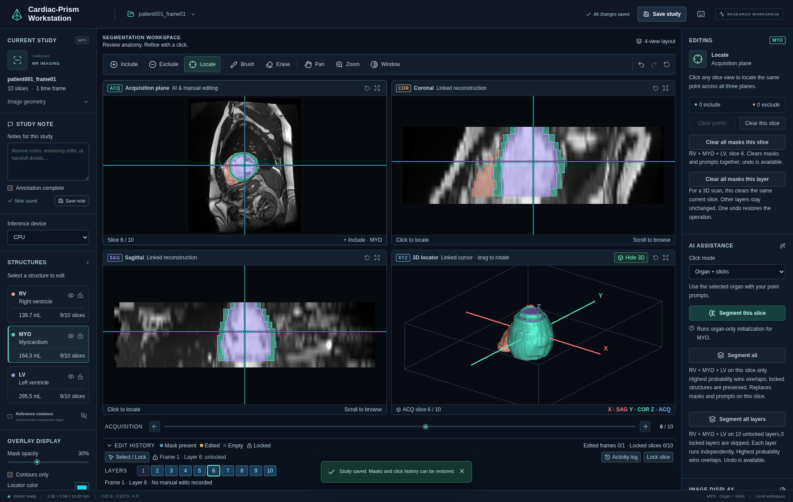

# Cardiac-Prism Workstation

A self-hosted workstation for viewing and refining cardiac MR segmentations. Open a 3D volume or 4D cine, inspect linked slice views, segment RV / MYO / LV, and refine the result with clicks or pixel-level tools. Images, annotations, and inference stay on your server.



*ACDC end-diastolic volume with its imported expert reference annotation; this screenshot illustrates the workstation interface. [Data attribution and terms](docs/sample-data.md).*

**Source-available for noncommercial use.** The workstation and released cardiac model use [PolyForm Noncommercial 1.0.0](LICENSE). Academic research and other permitted noncommercial purposes are supported; commercial uses outside the license's permitted purposes require separate permission. Upstream components and public sample data retain their own licenses. See [NOTICE](NOTICE).

The repository is currently distributed privately to authorized collaborators. Your GitHub account needs repository access and a working SSH key. Install Git LFS for the private model download; no personal access token is stored by the workstation.

This is research software. Review predictions before using them in an analysis; the release is not a validated diagnostic product.

## What is included

- Linked acquisition, two reconstruction, and 3D locator views with a shared position and time cursor.
- 3D NIfTI, 4D NIfTI cine, and a single classic MR DICOM series imported from a folder.
- Organ-based segmentation, positive and negative clicks, one-pixel brush and eraser, and undo / redo.
- All-structure segmentation for one slice, all layers in a frame, or all time frames; optional multiple-GPU execution.
- Same-layer temporal propagation from 1–3 reference frames, with protection for manual edits.
- Locks for selected frame × layer combinations, study notes, completion markers, and a readable activity history.
- On-demand 3D mask surfaces, annotation import, NIfTI export, and complete study backups.
- A versioned cardiac checkpoint and a public ACDC 4D example, downloaded separately with SHA-256 verification.

The model is **2D**: a click affects the current acquisition layer and time frame. Playback displays existing masks; propagation and whole-study segmentation are explicit actions.

## Quick start

The supported server target is **Linux x86-64**. Use an NVIDIA GPU for interactive inference; a CPU installation is also available. On a Mac or Windows computer, use a browser to connect to the server.

### Docker with an NVIDIA GPU

Install Docker Engine with Compose and the [NVIDIA Container Toolkit](https://docs.nvidia.com/datacenter/cloud-native/container-toolkit/latest/install-guide.html), then run:

```bash
git lfs install
git clone --branch main git@github.com:bangwayne/cardiac-prism.git
cd cardiac-prism
./scripts/docker.sh gpu up --build -d
```

The helper downloads the pinned checkpoint and public example, prepares persistent directories, and starts the workstation. The first build downloads dependencies and takes longer than subsequent starts.

### Docker on CPU

```bash
git lfs install
git clone --branch main git@github.com:bangwayne/cardiac-prism.git
cd cardiac-prism
./scripts/docker.sh cpu up --build -d
```

CPU inference is slower. Viewing, manual annotation, import, and export remain available.

### Without Docker

With Python 3.10, Git, and a C++ build toolchain installed:

```bash
git lfs install
git clone --branch main git@github.com:bangwayne/cardiac-prism.git
cd cardiac-prism
./scripts/setup.sh --device cuda
./start.sh
```

Use `--device cpu` for a CPU installation. The setup script creates an isolated `.venv`, installs pinned dependencies, prepares Node when needed, builds the frontend, and downloads the model and example. See the [full installation guide](docs/install.md) for prerequisites and configuration.

### Open the workstation

On the server itself, open **http://localhost:8502/**.

To connect from another computer, run this command in that computer's terminal and keep it open:

```bash
ssh -N -L 8502:127.0.0.1:8502 YOUR_USERNAME@YOUR_SERVER
```

Then open **http://localhost:8502/** on that computer. If local port 8502 is occupied, use `-L 8512:127.0.0.1:8502` and open **http://localhost:8512/**. The server binds to loopback by default and has no built-in user authentication.

## First session

1. Open **Library** and select the downloaded ACDC example, or upload your own `.nii` / `.nii.gz` volume.
2. Choose a layer and time frame. Pause playback before editing.
3. Select **RV**, **MYO**, or **LV**, then use **Segment this slice** or **Segment all**.
4. Refine with **Include**, **Exclude**, **Brush**, or **Erase**. Inspect other layers and frames.
5. Lock accepted frame/layer combinations in **Edit History** before a larger segmentation or propagation job.
6. Add a note, click **Save study**, and use **Full study backup** to download a portable copy.

Read the [user guide](docs/user-guide.md) for controls, data formats, locks, propagation, and save/export behavior.

## Model and example downloads

```bash
python3 scripts/download_assets.py --all
python3 scripts/download_assets.py --all --verify
```

For separate downloads, use `--weights` or `--sample`. The checkpoint is stored as `weight/cardiac-prism-v0.1.pth`, with its matching JSON profile alongside it; the public example is stored under `demo-data/`. **Model weights are hosted on GitHub**, through Release assets and a separate Git LFS asset history. No Hugging Face account or model download is required. Large assets are kept outside the main source branch. When a release asset is private or unavailable, the downloader uses your existing authorized Git SSH access through Git LFS, pinned to the `models/v0.1.1` asset tag. The [model card](docs/model-card.md) describes the checkpoint, preprocessing, and limitations. The [sample-data guide](docs/sample-data.md) records ACDC provenance, attribution, and its separate noncommercial data license.

## Documentation

| Guide | Contents |
| --- | --- |
| [Installation](docs/install.md) | Docker, native setup, CPU/GPU selection, remote access, persistence, upgrades, troubleshooting |
| [User guide](docs/user-guide.md) | Input formats, views, editing, temporal propagation, locks, save and export |
| [Model card](docs/model-card.md) | Released weights, input preparation, labels, intended use |
| [Sample data](docs/sample-data.md) | Public cine example, reference annotation, attribution |
| [Development](docs/development.md) | Architecture, local development, tests, release checks |
| [Release validation](docs/validation.md) | Tested installations, model equivalence, application and persistence checks |
| [Contributing](CONTRIBUTING.md) | Bug reports and changes |
| [Security](SECURITY.md) | Deployment boundary and reporting vulnerabilities |
| [Changelog](CHANGELOG.md) | Versioned release notes |

## Acknowledgments and citation

The segmentation engine builds on [K-Prism](https://github.com/bangwayne/K-Prism). The viewer uses Cornerstone3D and vtk.js. Upstream copyright and license notices are preserved in [NOTICE](NOTICE), [licenses/](licenses/), and [THIRD_PARTY_NOTICES.txt](THIRD_PARTY_NOTICES.txt).

If you use the workstation in research, cite this repository and its release version using [CITATION.cff](CITATION.cff). Also cite the K-Prism method and ACDC when using the distributed example:

> Bangwei Guo et al. *K-Prism: A Knowledge-Guided and Prompt Integrated Universal Medical Image Segmentation Model*. ICLR, 2026. [Paper](https://openreview.net/forum?id=gvRf95K4im).

ACDC citation details are provided with the [sample data](docs/sample-data.md).
