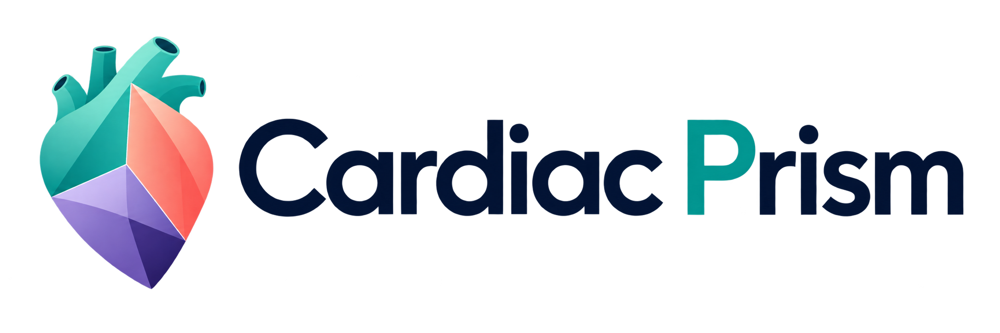

<p align="center">
  
</p>

# Cardiac-Prism Workstation

**[Download the original tutorial · 6:55 (MP4)](docs/media/Cardiac-Prism-Tutorial.mp4)** · **[Read the illustrated user guide (PDF)](docs/media/Cardiac-Prism-User-Guide.pdf)**

Connect, open a study, explore the views, segment and refine masks, then save your work. The tutorial includes English narration and captions; the illustrated guide is 17 pages.

https://github.com/user-attachments/assets/430abae0-7cf6-46a2-89dd-871434937de6

*Tutorial and guide visuals use the public ACDC example, with model predictions and demonstration edits. These derived visuals retain ACDC's CC BY-NC-SA 4.0 terms; see [data attribution and citation](docs/sample-data.md#license-and-citation).*

A self-hosted workstation for **cardiac cine MRI segmentation and annotation**. The current release supports three structures: **left ventricular cavity (LV), right ventricular cavity (RV), and left ventricular myocardium (MYO)**. Open a 3D cardiac volume or 4D cine, inspect linked slice views, and refine masks with clicks or pixel-level tools. Images, annotations, and inference stay on your server.

The released checkpoint and workstation are configured for these three cardiac structures. For the underlying model's broader segmentation modes, imaging modalities, and datasets, see [K-Prism](https://github.com/bangwayne/K-Prism). We welcome research fine-tuning and community contributions that extend the platform.

**Source-available for noncommercial use.** The workstation and released cardiac model use [PolyForm Noncommercial 1.0.0](LICENSE). Academic research and other permitted noncommercial purposes are supported; commercial uses outside the license's permitted purposes require separate permission. Upstream components and public sample data retain their own licenses. See [NOTICE](NOTICE).

The repository is public. HTTPS cloning requires no GitHub account or access token.

> [!IMPORTANT]
> **Recommended installation: clone `main` with Git LFS, then follow [Quick start](#quick-start).** Install Git and Git LFS before cloning so that you receive both the application and the complete model weights. Docker and native installation commands are provided below.
>
> **Do not use Code → Download ZIP to install the workstation.** That source archive currently contains a Git LFS pointer instead of the model weights and is not a complete installation package.

This is research software. Review predictions before using them in an analysis; the release is not a validated diagnostic product.

## What is included

- Linked acquisition, two reconstruction, and 3D locator views with a shared position and time cursor.
- 3D NIfTI, 4D NIfTI cine, and a single classic MR DICOM series imported from a folder.
- Organ-based segmentation, positive and negative clicks, one-pixel brush and eraser, lasso fill/erase, and undo / redo.
- All-structure segmentation for one slice, all layers in a frame, or all time frames; optional multiple-GPU execution.
- Same-layer temporal propagation from 1–3 reference frames, with protection for manual edits.
- Locks for selected frame × layer combinations, study notes, completion markers, and a readable activity history.
- On-demand 3D mask surfaces, annotation import, NIfTI export, and complete study backups.
- A versioned cardiac checkpoint included through Git LFS, plus a public ACDC 4D example downloaded during setup; both verified by SHA-256.

The model is **2D**: a click affects the current acquisition layer and time frame. Playback displays existing masks; propagation and whole-study segmentation are explicit actions.

## Segmentation modes and fine-tuning

The workstation builds on [K-Prism](https://github.com/bangwayne/K-Prism), a model that combines semantic knowledge, interactive prompts, and reference examples:

| Mode | Workstation use |
| --- | --- |
| Automatic / semantic | Select LV, RV, or MYO and segment a slice, frame, or full cine. |
| Interactive | Refine the selected structure with positive and negative clicks. Brush and eraser provide direct manual correction. |
| Reference-based | Use annotated reference frames to propagate a structure through time on the same acquisition layer. |

K-Prism's upstream research implementation supports segmentation across multiple medical imaging datasets and modalities. Researchers are welcome to fine-tune it on their own annotated data. Start with the [upstream training code and configurations](https://github.com/bangwayne/K-Prism#training). To integrate a checkpoint into this workstation, match its architecture, structure queries, label mapping, and preprocessing profile. Supporting additional organs or modalities also requires updating and testing the workstation adapter and controls; the supplied cardiac checkpoint is configured for LV / RV / MYO.

The released cardiac checkpoint was fine-tuned with expert annotations from **ACDC, M&Ms, and M&Ms-2**: 780 training subjects and 2,280 annotated ED/ES volumes, including M&Ms-2 short-axis and four-chamber views. See [training data and fine-tuning](docs/training-data.md) for dataset sources, splits, label mapping, and the training recipe. The separately downloaded ACDC cine is an example for trying the interface.

## Quick start

The supported server target is **Linux x86-64**. Use an NVIDIA GPU for interactive inference; a CPU installation is also available. On a Mac or Windows computer, use a browser to connect to the server.

Use one of the verified installation methods below. Each starts by cloning `main` with Git LFS. If Git or Git LFS is missing, follow the [prerequisite installation steps](docs/install.md#2-download-the-source-and-model) first.

### Docker with an NVIDIA GPU

Install Docker Engine with Compose and the [NVIDIA Container Toolkit](https://docs.nvidia.com/datacenter/cloud-native/container-toolkit/latest/install-guide.html), then run:

```bash
git lfs install
git clone --branch main https://github.com/bangwayne/cardiac-prism.git
cd cardiac-prism
./scripts/docker.sh gpu up --build -d
```

The clone retrieves the checkpoint through Git LFS. The helper verifies it, downloads the public example and any missing assets, prepares persistent directories, and starts the workstation. The first build downloads dependencies and takes longer than subsequent starts.

### Docker on CPU

```bash
git lfs install
git clone --branch main https://github.com/bangwayne/cardiac-prism.git
cd cardiac-prism
./scripts/docker.sh cpu up --build -d
```

CPU inference is slower. Viewing, manual annotation, import, and export remain available.

### Without Docker

With Python 3.10, Git, and a C++ build toolchain installed:

```bash
git lfs install
git clone --branch main https://github.com/bangwayne/cardiac-prism.git
cd cardiac-prism
./scripts/setup.sh --device cuda
./start.sh
```

Use `--device cpu` for a CPU installation. The setup script creates an isolated `.venv`, installs pinned dependencies, prepares Node when needed, builds the frontend, verifies the model, and downloads the example and any missing assets. See the [full installation guide](docs/install.md) for prerequisites and configuration.

### Open the workstation

On the server itself, open **http://localhost:8502/**.

To connect from another computer, run this command in that computer's terminal and keep it open:

```bash
ssh -N -L 8502:127.0.0.1:8502 YOUR_USERNAME@YOUR_SERVER
```

Then open **http://localhost:8502/** on that computer. If local port 8502 is occupied, use `-L 8512:127.0.0.1:8502` and open **http://localhost:8512/**. The server binds to loopback by default and has no built-in user authentication.

## First session

1. Open **Library** and select the downloaded ACDC example, or upload your own `.nii` / `.nii.gz` volume.
2. Choose a layer and time frame. Pause playback before editing.
3. Select **RV**, **MYO**, or **LV**, then use **Segment this slice** or **Segment all**.
4. Refine with **Include**, **Exclude**, **Brush**, **Erase**, or **Lasso**. Hold **H** to peek at the original image, use **← / →** to step through time, and **Ctrl + wheel** over a 2D view to resize the brush or eraser. Inspect other layers and frames.
5. Lock accepted frame/layer combinations in **Edit History** before a larger segmentation or propagation job.
6. Add a note, click **Save study**, and use **Full study backup** to download a portable copy.

Read the [user guide](docs/user-guide.md) for controls, data formats, locks, propagation, and save/export behavior.

## Model and example downloads

```bash
python3 scripts/download_assets.py --all
python3 scripts/download_assets.py --all --verify
```

For separate downloads, use `--weights` or `--sample`. The `main` branch includes `weight/cardiac-prism-v0.1.pth` through Git LFS, with its matching JSON profile alongside it. A normal clone with Git LFS installed retrieves the complete model. **Code and model weights are hosted on GitHub**; no Hugging Face account is needed. If cloning skipped the model download, run `git lfs pull`. The installer can also recover the checkpoint from the immutable `v0.1.2` source tag through Git LFS using the clone's Git remote.

The public example is downloaded separately under `demo-data/`. The [model card](docs/model-card.md) describes the checkpoint, preprocessing, and limitations. The [sample-data guide](docs/sample-data.md) records ACDC provenance, attribution, and its separate noncommercial data license.

## Documentation

Community contributions are welcome: bug reports, usability improvements, documentation, installation support, and reproducible model or dataset integrations. Open an [issue](https://github.com/bangwayne/cardiac-prism/issues) to discuss a proposed extension, or follow [Contributing](CONTRIBUTING.md) to submit code.

Community contributions go through pull requests to `develop`, followed by
maintainer review and automated tests. `main` remains the official installation
and release branch; the maintainer selects when reviewed changes are promoted.
See [Contributing](CONTRIBUTING.md) for the fork workflow.

| Guide | Contents |
| --- | --- |
| [Installation](docs/install.md) | Docker, native setup, CPU/GPU selection, remote access, persistence, upgrades, troubleshooting |
| [User guide](docs/user-guide.md) | Input formats, views, editing, temporal propagation, locks, save and export |
| [Model card](docs/model-card.md) | Released weights, input preparation, labels, intended use |
| [Training data and fine-tuning](docs/training-data.md) | ACDC, M&Ms, M&Ms-2, training split and recipe, adapting the model |
| [Sample data](docs/sample-data.md) | Public cine example, reference annotation, attribution |
| [Development](docs/development.md) | Architecture, local development, tests, release checks |
| [Release validation](docs/validation.md) | Tested installations, model equivalence, application and persistence checks |
| [Contributing](CONTRIBUTING.md) | Bug reports and changes |
| [Security](SECURITY.md) | Deployment boundary and reporting vulnerabilities |
| [Changelog](CHANGELOG.md) | Versioned release notes |

## Acknowledgments and citation

The segmentation engine builds on [K-Prism](https://github.com/bangwayne/K-Prism) and the multi-query segmentation work introduced in [VerSe](https://doi.org/10.1007/978-3-031-96628-6_25). The viewer uses Cornerstone3D and vtk.js. Required upstream notices are collected in [licenses/](licenses/); these are component attributions within the supplied model and viewer.

If you use Cardiac-Prism in research, please cite **both K-Prism (ICLR 2026) and VerSe (IPMI 2025)**, and identify the workstation release using [CITATION.cff](CITATION.cff). Cite the relevant datasets when using their images or annotations.

> Bangwei Guo et al. *K-Prism: A Knowledge-Guided and Prompt Integrated Universal Medical Image Segmentation Model*. ICLR, 2026. [Paper](https://openreview.net/forum?id=gvRf95K4im).

> Bangwei Guo, Meng Ye, Yunhe Gao, Bingyu Xin, Leon Axel, and Dimitris Metaxas. *VerSe: Integrating Multiple Queries as Prompts for Versatile Cardiac MRI Segmentation*. IPMI, 2025, pp. 373–387. [Paper](https://doi.org/10.1007/978-3-031-96628-6_25).

```bibtex
@inproceedings{guo2026kprism,
  title = {K-Prism: A Knowledge-Guided and Prompt Integrated Universal Medical Image Segmentation Model},
  author = {Guo, Bangwei and Gao, Yunhe and Ye, Meng and Gu, Difei and Zhou, Yang and Axel, Leon and Metaxas, Dimitris N.},
  booktitle = {The Fourteenth International Conference on Learning Representations},
  year = {2026},
  url = {https://openreview.net/forum?id=gvRf95K4im}
}

@inproceedings{guo2025verse,
  title = {VerSe: Integrating Multiple Queries as Prompts for Versatile Cardiac MRI Segmentation},
  author = {Guo, Bangwei and Ye, Meng and Gao, Yunhe and Xin, Bingyu and Axel, Leon and Metaxas, Dimitris},
  booktitle = {Information Processing in Medical Imaging},
  series = {Lecture Notes in Computer Science},
  volume = {15829},
  pages = {373--387},
  year = {2025},
  publisher = {Springer},
  doi = {10.1007/978-3-031-96628-6_25}
}
```

Dataset attribution and access details are provided with the [training data](docs/training-data.md) and [ACDC example](docs/sample-data.md).
